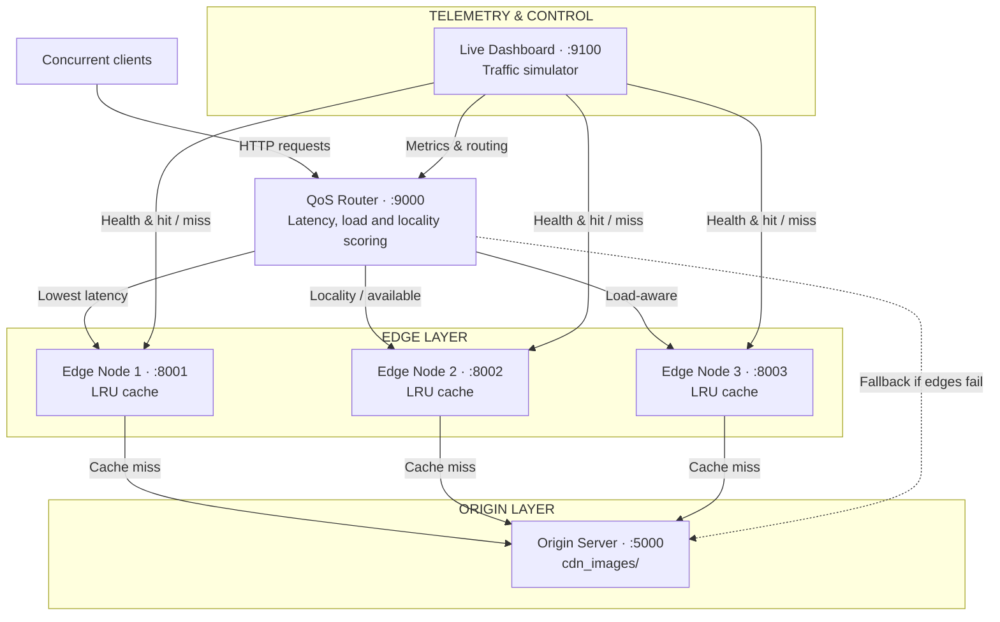

# AMRITA VISHWA VIDYAPEETHAM
### COMPUTER NETWORKS · PROJECT PRESENTATION

# QoS-Aware Edge Content Delivery Network & Live Telemetry Platform
**Intelligent low-latency edge selection, LRU cache management and real-time telemetry**

### Presented By
- **KVV Sathya Teja** ([@k-tejzz](https://github.com/k-tejzz))
- **K. Gowtham Reddy** ([@Gowthamreddyyyy](https://github.com/Gowthamreddyyyy))
- **Gnana Sai Varma K** ([@GnanaSaiVarmaK](https://github.com/GnanaSaiVarmaK))
- **Varun Tej** ([@varuntej0817](https://github.com/varuntej0817))
- **R Pradyumna** ([@pradyumna0222](https://github.com/pradyumna0222))

---

## Slide 01 · Abstract
*(Page 02 / 14)*

### Core Problem
Centralized delivery and static load balancing suffer from edge imbalance, latency spikes and ungraceful failures under sudden load surges.

### Proposed Solution: A Multi-Tier Edge CDN With
- **QoS routing** on EWMA latency, active connections and cache locality
- **Independent edge disk caches** with bounded LRU eviction (128 MB)
- **Edge-to-edge retry and origin fallback** when no edge is available
- **Live dashboard** with a load simulator for up to 100 concurrent clients

### Key Findings (Measured)
- **4.9 ms vs 10.1 ms:** Median latency, cache hit vs cache miss
- **32% → 13%:** Overloaded edge’s share of traffic, with no failed requests
- **100% served:** During a simulated edge outage

---

## Slide 02 · Introduction and Problem Statement
*(Page 03 / 14)*

> Web video, high-resolution media and interactive services keep growing, and every request that travels back to a central origin adds delay and load.

| Problem Area | Challenge & Impact |
| :--- | :--- |
| **High propagation latency** | Clients far from a central origin see a high round-trip time on every request. |
| **Origin bottleneck** | Traffic spikes saturate the origin’s CPU and bandwidth. |
| **Static / round-robin routing** | DNS and round-robin balancers ignore real-time edge congestion and which edge already holds the object. |
| **Cache thrashing** | Unbounded or naive caching exhausts disk and serves stale content. |

---

## Slide 03 · Project Objectives
*(Page 04 / 14)*

- **01 | Deploy a distributed edge layer:** Three independent edge caching processes, each with isolated local disk storage.
- **02 | Develop a QoS-aware routing gateway:** Dynamic edge selection using measured latency, active load and cache locality.
- **03 | Implement a bounded LRU cache:** A 128 MB capacity per edge with automatic least-recently-used eviction.
- **04 | Build fault tolerance and fallback:** Retry across surviving edges, then fall back to the origin if no edge is reachable.
- **05 | Provide a real-time telemetry dashboard:** Mean and p95 latency, edge health counters and a configurable client load generator.

---

## Slide 04 · Architecture Overview
*(Page 05 / 14 — Methodology)*



---

## Slide 05 · QoS Routing Model
*(Page 06 / 14 — Methodology)*

### Edge Score (Lowest Wins)
$$\text{Score} = \text{Latency}_{\text{EWMA}} + 15 \times \text{ActiveConnections} + 150 \times \text{FailureStreak} - 10{,}000 \times \text{Cached}$$

### Scoring Components
- **Latency (EWMA):** $0.75 \times \text{old} + 0.25 \times \text{sample}$ — Smooths each edge’s measured response time.
- **Concurrency (+15):** Per in-flight request: steers new traffic away from busy edges.
- **Failure streak (+150):** Per consecutive failure: quickly deprioritizes flaky nodes.
- **Locality (−10,000):** If the edge already holds the file, it is effectively always chosen: a near-certain cache hit.

### Operational Modes
- **Client hint:** Each request carries $\text{randint}(0, 3)$. A healthy preferred edge (1–3) is tried first; 0 uses the score.
- **Overload mode:** Weighted random selection, degraded edge weight $0.30 \rightarrow$ about 13% of picks vs 43.5% for each healthy peer.

---

## Slide 06 · Edge Caching and LRU Eviction
*(Page 07 / 14 — Methodology)*

### Storage Mechanics
- Isolated cache directory per edge: `cache/edge1`, `edge2`, `edge3`
- Atomic writes: data lands in a `.tmp-*` file, then is renamed into place
- No partial or corrupt reads if a transfer is interrupted

### LRU Eviction
- Bounded at 128 MB per edge by default (`EDGE_CACHE_MAX_BYTES`)
- Every cache hit refreshes the file’s timestamp
- Over capacity, the oldest timestamps are evicted first

### Header Telemetry
- `X-Cache`: `HIT` / `MISS`
- `X-Edge-ID`
- `X-Edge-Time-Ms`
- `X-Routed-Edge`
- `X-Router-Time-Ms`

> **MEASURED:** 97.2% hit ratio in a 40-second cold-start run (44 misses in 1,597 requests); 100% once caches were warm.

---

## Slide 07 · Technology Stack
*(Page 08 / 14 — Implementation)*

| Layer | Technology |
| :--- | :--- |
| **Backend** | Python 3 and Flask microservices with REST endpoints |
| **HTTP client** | Requests library for all inter-service HTTP calls |
| **Transport** | HTTP/1.1, streamed relay, byte-range support (`Range` / `Content-Range`) for video seeking |
| **Concurrency** | Python `threading`; Lock-protected shared state; background heartbeat thread |
| **Telemetry UI** | HTML5, CSS3 and vanilla JavaScript polling `/api/state` |
| **Automation** | `START_LIVE_DEMO.bat`: one-click launch of all services |

### Six Active Processes
- **Origin server:** `:5000`
- **Edge 1, 2, 3:** `:8001`–`:8003`
- **QoS router:** `:9000`
- **Live dashboard:** `:9100`

---

## Slide 08 · Fault Tolerance and Fallback Strategy
*(Page 09 / 14 — Implementation)*

```
[ LAYER 1: Health Probing ]
  • Edge health cached for 1.5 s, re-probed on demand
  • Probes time out at 600 ms so clients never stall
  • Dashboard heartbeat every 3 s
            │
            ▼
[ LAYER 2: Multi-Edge Failover ]
  • Socket error or HTTP 5xx: the edge is skipped and its failure streak rises
  • The next-ranked edge is tried immediately
            │
            ▼
[ LAYER 3: Origin Fallback ]
  • No edge available: the router fetches from the origin directly
  • Response tagged X-Routed-Edge: origin-fallback
```

> **MEASURED:** With all three edges excluded, 70 of 70 requests were still served via origin fallback (HTTP 200).

---

## Slide 09 · Experimental Results: Latency and Throughput
*(Page 10 / 14 — Results)*

| Metric | Cache hit (edge) | Cache miss (origin fetch) | Origin fallback |
| :--- | :--- | :--- | :--- |
| **Requests measured** | 280 | 70 | 70 |
| **Median latency (p50)** | **4.9 ms** | 10.1 ms | 4.8 ms |
| **Mean latency** | **5.4 ms** | 13.9 ms | 5.4 ms |
| **Tail latency (p95)** | **8.4 ms** | 23.0 ms | 8.7 ms |

### Key Observations
- **$\approx$ 2× faster:** Median on a cache hit vs a miss; p95 drops from 23.0 to 8.4 ms.
- **254 req/s:** Sustained on a warm cache with 50 client threads, 0 errors in 15 s.
- **Test Conditions:** All services on one machine over localhost; 14 files (13 JPEG, 1 MP4). The origin is local, so fallback costs about the same as a hit here.

---

## Slide 10 · Dynamic Overload and Outage Adaptation
*(Page 11 / 14 — Results)*

### Share of Routed Requests
*(25 clients, 40 s per scenario, about 1,600 requests each)*

| Scenario | Edge 1 | Edge 2 | Edge 3 | Analysis |
| :--- | :---: | :---: | :---: | :--- |
| **Normal** | 32% | 35% | 33% | Balanced multi-edge traffic distribution |
| **A · Edge 1 overloaded** | **13%** | **42%** | **45%** | Overload on Edge 1 switched router to weighted selection (0.30). Edges 2 and 3 handled 87% of requests; 835 redirected; 0 failed. |
| **B · Edge 2 down** | **49%** | **0%** | **51%** | Edge 2 excluded from dispatch (received 0 requests). Edges 1 and 3 served all 1,605 with 0 failures. |
| **After recovery** | 32% | 34% | 34% | Shares returned to normal after restore. |

---

## Slide 11 · Project Demo Walkthrough
*(Page 12 / 14 — Results)*

- **1 | Batch startup:** One click launches the origin, three edges, router and dashboard.
- **2 | Cold run:** First pass shows cache misses, origin retrieval and cache storage.
- **3 | Warm run:** Repeat requests hit the cache: 100% hit rate.
- **4 | Stress simulator:** Scale from 5 to 50 concurrent client threads (up to 100 supported).
- **5 | Live visualization:** Event log, cache badges, node health and overload / outage controls.

---

## Slide 12 · Conclusion
*(Page 13 / 14 — Conclusion & Future Work)*

- :white_check_mark: **Built and validated** a functional, distributed QoS edge CDN prototype.
- :white_check_mark: **Formulated and tested** a composite routing score balancing latency, active connections and cache locality.
- :white_check_mark: **Implemented multi-level fault tolerance** with transparent origin fallback.
- :white_check_mark: **Developed a real-time monitoring and benchmarking** dashboard.

> **Core Value:** Demonstrates practical edge-computing benefits for media delivery: lower latency on cache hits, and continued service under overload and edge failure.

---

## Slide 13 · Future Work
*(Page 14 / 14 — Conclusion & Future Work)*

| Proposed Enhancement | Description |
| :--- | :--- |
| **Predictive pre-fetching** | Machine-learning models that predict demand from consumption history. |
| **GeoDNS and BGP anycast** | Wide-area deployment across geographically separated nodes. |
| **Edge-to-edge cache sharing** | Peer lookup between edges before querying the central origin. |
| **Security and DDoS mitigation** | Token-based edge rate limiting and TLS termination at edge nodes. |

---

## Repository
- **GitHub:** [https://github.com/pradyumna0222/edge-cdn-qos](https://github.com/pradyumna0222/edge-cdn-qos)
