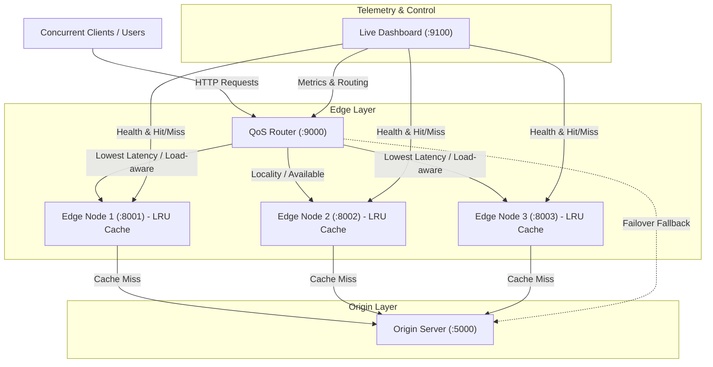

# QoS-Aware Edge CDN & Live Monitoring Platform

A distributed, portable Content Delivery Network (CDN) prototype featuring autonomous edge caching with LRU eviction, dynamic QoS-aware load balancing, origin fallback, and a real-time web telemetry dashboard.

---

## Architecture Overview



---

## Key Features

- **Decentralized Edge Nodes (`edge_node.py`)**:
  - Independent disk-backed caches with Least-Recently-Used (LRU) bounded capacity eviction.
  - Per-node telemetry tracking hit/miss ratios, origin fetches, network errors, and served bytes.
  - Transparent upstream asset fetching and background cache writing.

- **Intelligent QoS Router (`qos_router.py`)**:
  - Scores edge candidates based on measured round-trip time (RTT), active in-flight requests, and cached object locality.
  - Automatic retry mechanism across surviving edges.
  - Fail-safe direct origin fallback if edge nodes are unreachable.

- **Origin Server (`origin_server.py`)**:
  - Central repository serving images, presentation slides, and multimedia content.
  - Serves SHA-256 asset metadata and health endpoints.

- **Interactive Telemetry Dashboard & Simulator (`live_dashboard.py`)**:
  - Multi-client concurrent load simulator (adjustable from 5 to 100 concurrent virtual clients).
  - Real-time visualization of p50/p95 latency, throughput, cache hit rate, and node health.

---

## Project Structure

```
├── .gitignore
├── requirements.txt
├── README.md
└── qos_edge_cdn_v1/
    ├── origin_server.py        # Central media origin server (:5000)
    ├── edge_node.py            # Edge caching service (:8001, :8002, :8003)
    ├── qos_router.py           # Intelligent QoS routing gateway (:9000)
    ├── live_dashboard.py       # Telemetry UI & traffic generator (:9100)
    ├── START_LIVE_DEMO.bat     # One-click Windows startup script
    ├── cdn_images/             # Static media assets & sample video/presentation
    ├── cache/                  # Per-edge cache partitions (edge1, edge2, edge3)
    ├── README.md               # v1 core documentation
    └── README_LIVE_DEMO.md     # Live multi-client benchmark guide
```

---

## Quick Start

### 1. Prerequisites
- Python 3.10+
- Install dependencies:
```bash
pip install -r requirements.txt
```

### 2. Automatic Start (Windows)
Double-click `qos_edge_cdn_v1/START_LIVE_DEMO.bat` or run:
```powershell
cd qos_edge_cdn_v1
.\START_LIVE_DEMO.bat
```
This automatically boots all 5 services and opens the live web dashboard in your browser.

### 3. Manual Start
Run each service in a separate terminal:

```bash
# 1. Start Origin Server (Port 5000)
python qos_edge_cdn_v1/origin_server.py

# 2. Start Edge Nodes (Ports 8001, 8002, 8003)
python qos_edge_cdn_v1/edge_node.py --id edge1
python qos_edge_cdn_v1/edge_node.py --id edge2
python qos_edge_cdn_v1/edge_node.py --id edge3

# 3. Start QoS Router (Port 9000)
python qos_edge_cdn_v1/qos_router.py

# 4. Start Live Dashboard (Port 9100)
python qos_edge_cdn_v1/live_dashboard.py
```

Access the UI at: **`http://127.0.0.1:9100`**

---

## Service Endpoints & Ports

| Service | Port | Key Endpoints | Description |
| :--- | :--- | :--- | :--- |
| **Origin Server** | `5000` | `/files`, `/files/<name>`, `/health` | Source of truth for assets |
| **Edge 1** | `8001` | `/get/<name>`, `/health`, `/metrics` | Edge node with local LRU cache |
| **Edge 2** | `8002` | `/get/<name>`, `/health`, `/metrics` | Edge node with local LRU cache |
| **Edge 3** | `8003` | `/get/<name>`, `/health`, `/metrics` | Edge node with local LRU cache |
| **QoS Router** | `9000` | `/fetch/<name>`, `/stats` | Load-balanced gateway |
| **Live Dashboard** | `9100` | `/`, `/api/state`, `/api/start` | Real-time monitoring & traffic generator |

---

## Author
- **RAMADURGAM PRADYUMNA** ([@pradyumna0222](https://github.com/pradyumna0222))
